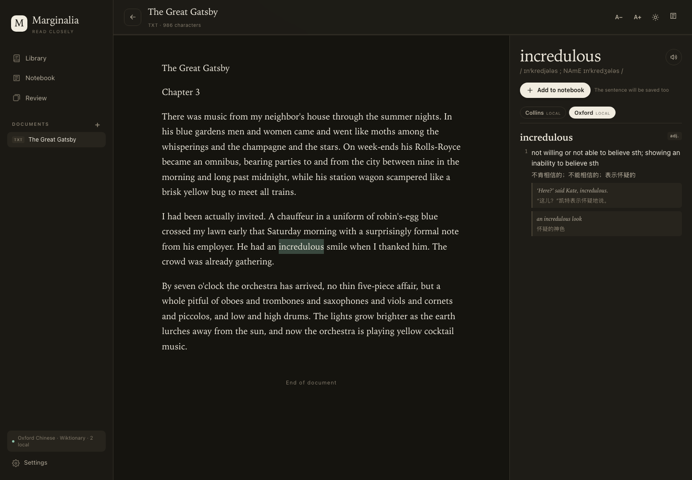
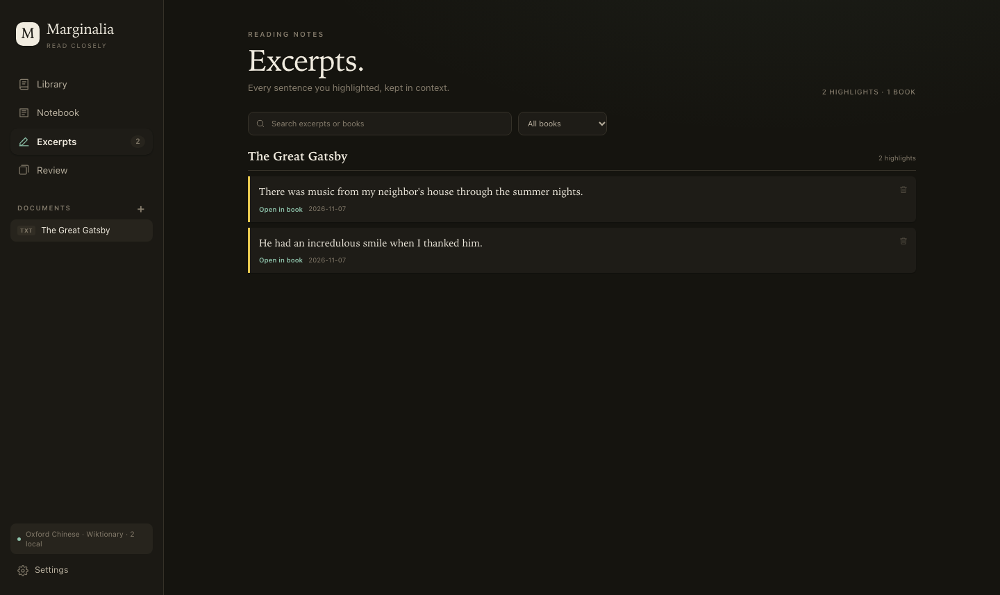

> [中文说明](README.md) · English

# Marginalia

**A local English reader for close reading.** Drop in a PDF, Word document, EPUB,
or plain text; select a word; read its English and Chinese definitions; keep it
in a notebook and review it later.

Marginalia runs on your Mac. There is no account, no cloud sync, and no analytics.



[Reader's guide (DOCX)](docs/Marginalia_Readers_Guide.docx) ·
[Publishing to GitHub](PUBLISHING.md)

## Why “Marginalia”?

*Marginalia* are the notes a reader leaves in the margin of a book — a gloss, a
question, a translation, a line worth returning to. The word comes from Latin
*marginalis*, “of the margin.”

The name states a view of reading: understanding is not passive reception. A
reader who stops, looks up a word, notices a strange collocation, or copies a
sentence into a notebook is doing something with the text. Marginalia rebuilds
that margin as a dictionary panel and a notebook. It does not literally draw on
the PDF page; the point is the reading relationship, not a facsimile.

## Features

- **Local library** for PDF, DOCX, EPUB, TXT, Markdown, and HTML.
- **Selection lookup**: highlight a word (or a short phrase) and the side panel
  fills with definitions, phonetics, examples, and Chinese equivalents.
- **Three dictionary layers**:
  - **Local MDX dictionaries** you index yourself (for example Collins COBUILD
    and Oxford Advanced Learner's). Local results take precedence and are
    rendered as structured entries: part of speech, numbered senses, examples,
    Chinese translations, and synonyms.
  - Chinese ↔ English from the **Oxford Chinese Dictionary** installed in
    macOS Dictionary, read locally through DictionaryServices.
  - English → English from **Wiktionary** by default, or **Merriam-Webster
    Learner's** if you add a free API key in Settings.
- **Vocabulary notebook**: saves the word, both definitions, the phonetic, and
  the sentence in which you met it.
- **Spaced review**: Again / Hard / Good / Easy, with a familiar SM-2-style
  schedule. Space reveals; 1–4 grade.
- **PDF cleanup**: removes repeated running heads and footers, page numbers,
  publisher metadata, and small bottom-of-page notes before the text reaches
  the reader.
- **Text check**: every upload is normalized before reading. Hard-wrapped lines
  are joined, hyphenated words repaired, broken paragraphs merged, and repeated
  page furniture removed. A report lists what changed and flags possible
  structural problems.
- **Sentence highlights**: select a passage and click **Highlight sentence** to
  mark the full sentence in fluorescent yellow. **Excerpts** collects every
  highlight across the library, grouped by book, searchable, and linked back to
  the exact paragraph.
- **Reading comfort**: saved scroll position, adjustable type size, light/dark
  themes, and a mobile layout.
- **Local data**: one SQLite file; JSON export for the notebook.

## Requirements

- macOS 12 or newer.
- For running from source: **Python 3.10+** and the Xcode Command Line Tools
  (for `swiftc`). The launcher creates a private virtual environment; you do not
  need to install Python packages globally.
- For the prebuilt app: Apple Silicon (arm64). It is self-contained and does not
  need Python.

## Quick start

### Option A — run from source

```bash
git clone https://github.com/your-name/marginalia.git
cd marginalia
./start.command
```

Or double-click **`Marginalia.command`** in Finder.

The first launch creates `.venv`, installs `pypdf` and `beautifulsoup4`, and
builds two small Swift helpers for the local dictionary and PDFKit text
extraction. Later launches are fast. The browser opens at
`http://127.0.0.1:8765/`; close the Terminal window to stop the server.

If macOS blocks the script, right-click → **Open**.

### Option B — prebuilt macOS app

Build a self-contained app:

```bash
./scripts/build_macos_app.sh
```

This produces `dist/Marginalia.app` and
`dist/Marginalia-macOS-arm64.zip`. Copy the `.app` to another Apple Silicon Mac
and double-click it. The app keeps its data in
`~/Library/Application Support/Marginalia/`.

## Reading

1. Drop a file onto the Library drop zone, or click **Add document**.
2. Highlight a word in the reading column.
3. Read the dictionary panel; click **Add to notebook** to keep the word and
   its sentence.
4. Open **Notebook** to search and manage words, or **Review** to study what is
   due.

PDF page breaks appear as thin markers. The original page image is not shown;
the text is reflowed for reading and lookup.

## Text check

Before a document reaches the reader it goes through a conservative layout
check:

- joins lines that are hard-wrapped by the source column;
- repairs `inter-` / `national` hyphenation;
- merges paragraphs only when the second clearly continues the first;
- removes repeated running heads, page numbers, ligatures, soft hyphens, and
  stray whitespace;
- preserves lists, headings, page markers, and paragraphs that already look
  deliberate.

The **Text check** chip beside the document title opens a report with counts for
each repair and warnings such as “30 paragraphs end without clear punctuation.”
The original file is unchanged; this is heuristic cleanup, not OCR. If a source
uses poetry, tables, or unusual typography, the report is the place to notice
it.

## Highlights and excerpts



1. Select a sentence (or part of one) in the reading column.
2. Click **Highlight sentence** in the small toolbar. The selection expands to
   the sentence boundaries and is saved in yellow.
3. Open **Excerpts** in the sidebar to see every highlight, grouped by book.
   Search or filter by book, click **Open in book** to jump back to the
   paragraph, or remove a highlight.

Highlights live in the same local SQLite database as documents and the
notebook. The JSON export includes them.

## PDF cleanup: what it does and does not do

Marginalia uses macOS PDFKit to inspect each line's text, font size, and
position. It then removes:

- running heads and footers that repeat across pages;
- page numbers and roman-numeral folios;
- common publisher metadata (`arXiv:`, copyright lines, DOI/ISSN, download
  stamps, “provided proper attribution”, and similar);
- small-print notes near the bottom of a page (a heuristic for footnotes).

It then joins lines into paragraphs and preserves page markers. This makes
academic papers and books noticeably cleaner than raw PDF text.

It is still a heuristic:

- scanned/image-only PDFs need OCR, which is not included;
- tables, multi-column layouts, sidebars, and captions can still be imperfect;
- footnotes that use the same font size as the body may survive;
- a PDF with unusual typography may need manual cleanup.

The app falls back to `pypdf` if PDFKit is unavailable.

## Dictionaries and `.eubak` files

Marginalia does **not** bundle commercial dictionaries. The Chinese side reads
the Oxford Chinese Dictionary that is already installed in macOS Dictionary.
If that dictionary is missing, the app says so instead of inventing a
translation.

A `.eubak` file is **not** a dictionary. It is a small Frhelper/欧路词典 backup
that contains only the path of an `.mdx` file on the phone. The two `.eubak`
files supplied with this project are 380 and 420 bytes and contain no headwords.
To use those dictionaries, you need the actual `.mdx`/`.mdd` files; see
[`dictionaries/README.md`](dictionaries/README.md).

### Using the real `.mdx` files

The app includes a local MDX importer for v2.0 dictionaries:

1. Copy the `.mdx` files into the folder shown in **Settings → Local
   dictionaries** (for a source checkout this is
   `data/dictionaries/`; for the app it is
   `~/Library/Application Support/Marginalia/dictionaries/`).
2. Open **Settings → Local dictionaries → Index dictionaries**. The first
   index of the Collins and Oxford files takes about two minutes.
3. Look up a word. Local entries are shown first and override the online/macOS
   sources for that word.

The importer reads headwords and HTML definitions, converts them to plain text,
and skips `@@@LINK` redirections. `.mdd` audio/image resources are not used.

Do not commit `.mdx`, `.mdd`, or `.eubak` files. They are licensed content, and
they are ignored by `.gitignore`.

## Data and backup

- Source checkout: `data/reader.db`.
- Prebuilt app: `~/Library/Application Support/Marginalia/reader.db`.
- **Settings → Notebook → Export** downloads a JSON copy of the notebook,
  including definitions, context, and review state, plus reading highlights.
- Documents are stored in the same SQLite database. The notebook export does not
  contain the full text of documents.
- The server listens only on `127.0.0.1`; nothing is exposed to the local
  network.

## Project layout

```
marginalia/
├─ app.py                  # HTTP server, parsing, dictionaries, review API
├─ static/                 # reader UI (HTML/CSS/JS)
├─ bin/
│  ├─ dictlookup.swift     # macOS DictionaryServices helper
│  └─ pdftext.swift        # PDFKit line/size/position helper
├─ scripts/
│  ├─ build_helpers.sh
│  └─ build_macos_app.sh
├─ docs/
│  ├─ reader.png
│  └─ Marginalia_Readers_Guide.docx
├─ dictionaries/           # local dictionary notes; licensed data is ignored
├─ data/                   # runtime database (ignored)
├─ requirements.txt
├─ start.command
└─ Marginalia.command
```

## Development

```bash
python3 -m venv .venv
.venv/bin/pip install -r requirements.txt
.venv/bin/python app.py --no-browser
```

Build the native helpers:

```bash
./scripts/build_helpers.sh
```

The server is a small `http.server` application; no Flask/Django. The UI is
vanilla HTML/CSS/JS. Dictionary results are cached in SQLite for seven days.

## License

Code is released under the [GNU GPL v3](LICENSE). The MDX parser (`readmdict`) is GPL-3.0, so the combined distribution is GPL-3.0. See [THIRD_PARTY_NOTICES.md](THIRD_PARTY_NOTICES.md).

Dictionary content is **not** included. Oxford, Collins, Merriam-Webster, and
other dictionary names belong to their respective owners. Marginalia reads the
Oxford Chinese Dictionary already licensed through macOS and links to
Merriam-Webster/Wiktionary services; it does not redistribute their data.

## 中文快速开始

双击 `Marginalia.command`（或运行 `./start.command`）。第一次启动会创建
Python 环境并编译两个本地辅助程序，之后浏览器会打开
`http://127.0.0.1:8765/`。关闭 Terminal 即停止。

- 拖入 PDF / DOCX / EPUB / TXT / MD / HTML。
- 选中单词即可查看英英和中英释义。
- 中文释义来自 macOS 词典里的《牛津英汉汉英词典》；英文默认 Wiktionary，
  可在 Settings 中填入免费的 Merriam-Webster key。
- 生词本会保存单词和原句，Review 用四档间隔重复复习。
- `.eubak` 只是欧路词典的备份配置，不含词条；不要把它当作词典文件。
- 数据在 `data/reader.db`（源码运行）或
  `~/Library/Application Support/Marginalia/reader.db`（独立 App）。
