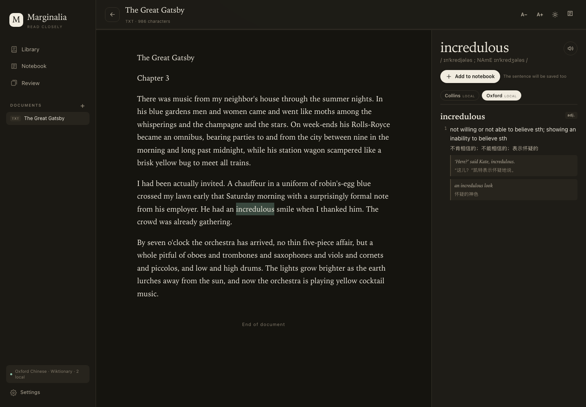
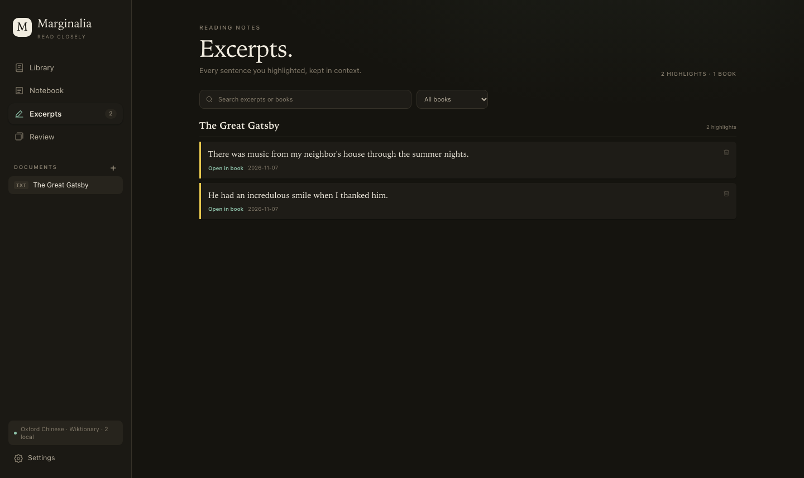

# Marginalia

**给中国学习者的本地英语精读工具。**

把 PDF、Word、EPUB 或 TXT 拖进来，选中一个词看英英和中英释义；选中一句话，用荧光笔留下摘录；把生词和原句收进生词本，再按间隔重复复习。所有数据只保存在这台 Mac 上，没有账号，没有云端，没有广告。





[English README](README.en.md)

---

## 为什么做这个

中国学习者读英文书，常见的问题不是“没有词典”，而是：

- 查词要切到另一个 App，回来找不到读到哪；
- 词典给了一堆释义，却不知道哪一个适合眼前这句话；
- 生词本只有单词，没有原句，复习时想不起语境；
- PDF 导进阅读器后，页眉、页码、断行全混在正文里；
- 读完整本书，想回看自己划过的句子，却没有地方汇总。

Marginalia 想解决的正是这几件事：**在原文里查词，在语境里记词，把值得回看的句子留下来。**

它不会用 AI 编造释义，也不会把商业词典打包进仓库。词典来源要么是你 Mac 上已安装的词典，要么是你自己合法持有的 MDX 文件，要么是 Wiktionary / Merriam-Webster 这样的公开接口。

## 功能一览

- **本地书库**：PDF、DOCX、EPUB、TXT、Markdown、HTML。
- **选词查询**：英英 + 中英释义、音标、例句；支持词形还原，例如选中 `abated` 会查 `abate`。
- **本地词典优先**：可导入自己持有的 Collins、牛津高阶等 MDX 词库，查词时本地优先，离线可用。
- **中文释义**：读取 macOS 词典中已安装的《牛津英汉汉英词典》；没有安装时会明确提示，而不是编造翻译。
- **文本检查**：上传后自动修复硬换行、断词、断裂段落，清理重复页眉页脚和页码，并给出检查报告。
- **句子高亮**：选中句子即可用荧光黄标出；所有高亮汇总在 **Excerpts（摘录）** 里，按书分组、可搜索、可跳回原文。
- **生词本**：保存单词、释义、音标和原句；支持 JSON 导出。
- **间隔复习**：Again / Hard / Good / Easy 四档，按记忆情况安排下次复习。
- **阅读舒适**：字号调整、深浅色主题、阅读进度保存、移动端布局。
- **隐私**：只监听 `127.0.0.1`，不联网同步，不上传文档。

> 界面目前是英文的。下面按界面上的英文按钮写操作步骤；这本身也算一次轻量的英语接触。如果你希望界面中文化，可以在 GitHub Issues 里提出。

## 5 分钟上手

### 方式 A：下载 macOS App（推荐）

1. 打开仓库右侧的 **Releases**，下载 `Marginalia-macOS-arm64.zip`。
2. 解压，把 `Marginalia.app` 拖进“应用程序”文件夹。
3. 第一次打开时，macOS 可能提示“无法验证开发者”。在 Finder 里 **右键 → 打开**，再确认一次即可。
4. App 会在浏览器里打开 `http://127.0.0.1:8765/`。把书拖进页面，或点击 **Add document**。
5. 选中一个词，右侧出现释义；选中一句话，点击浮出的 **Highlight sentence**。
6. 左侧 **Excerpts** 查看所有摘录；**Notebook** 查看生词；**Review** 开始复习。

App 的数据在：

```
~/Library/Application Support/Marginalia/reader.db
```

关闭 App 或退出 Dock 图标即可停止本地服务。

> 目前提供的是 Apple Silicon（arm64）版本。Intel Mac 请用下面的源码方式运行；Windows 和 Linux 不支持，因为中文词典读取和 PDF 版面分析依赖 macOS。

### 方式 B：从源码运行

要求：

- macOS 12 或更新版本；
- Python 3.10+；
- Xcode Command Line Tools（提供 `swiftc`）。

```bash
git clone https://github.com/YOUR-NAME/marginalia.git
cd marginalia
./start.command
```

也可以双击仓库里的 **`Marginalia.command`**。

如果从 GitHub 网页上传/下载后双击没有反应，通常是可执行权限丢失。打开 Terminal 执行：

```bash
chmod +x start.command Marginalia.command
./start.command
```

第一次启动会自动创建 `.venv`、安装依赖，并编译两个本地小工具：词典查询和 PDF 文本提取。以后启动很快。浏览器会打开 `http://127.0.0.1:8765/`；关闭 Terminal 窗口即停止。

源码方式的数据在仓库的 `data/reader.db`。

## 日常怎么用

| 想做的事 | 操作 |
|---|---|
| 导入一本书 | 拖进页面，或点 **Add document** |
| 查一个词 | 在正文中选中单词，右侧自动查询 |
| 查一个短语 | 最多选 4 个词；更长的句子不会触发查词 |
| 高亮一句话 | 选中句子 → 浮出的 **Highlight sentence** |
| 看所有摘录 | 左侧 **Excerpts** |
| 看生词本 | 左侧 **Notebook** |
| 复习生词 | 左侧 **Review** |
| 调整字号 | 右上角 `A−` / `A+` |
| 换深浅色 | 右上角月亮/太阳图标 |
| 导出数据 | **Settings → Notebook → Export** |

### 查词时看什么

右侧词典面板按来源分成标签页：

- **Collins / Oxford**：你自己导入的本地 MDX 词库；
- **Wiktionary / Merriam-Webster**：没有本地词库时的在线回退；
- **中文**：macOS 词典里的牛津中英词典。

本地词库存在时，会优先显示本地内容，不再请求在线词典。每个词条会尽量拆成：

- 词头、词性、音标；
- 编号义项；
- 英文释义；
- 中文翻译（如果词库有）；
- 例句；
- 同义词（Collins）。

释义太长时，默认只显示前三个义项，点 **Show all N senses** 展开。像 `run` 这种义项非常多的词，建议先看词性和前几个义项，不要一次读完。

### 词形变化

选中 `abated`、`running`、`studies` 这类词时，程序会尝试查原形。如果查不到，选中词根再试一次。专有名词、缩写、非常见短语可能没有结果。

### 发音

有音标时，点击词头右侧的喇叭按钮，用 macOS 的语音合成朗读。它不是真人录音；本地 `.mdd` 里的真人发音包目前没有使用。

## 导入自己的 MDX 词库（重要）

Marginalia **不附带**任何商业词典。你要使用 Collins、牛津高阶等词库，需要自己拥有对应的 `.mdx` 文件。

### `.eubak` 不是词库

欧路词典/Frhelper 的 `.eubak` 只是备份配置，通常只有几百字节，里面记录的是手机上的 `.mdx` 路径，例如：

```xml
<Item libid="1344212299"
      path="/var/mobile/.../Documents/牛津高阶英汉双解词典(第8版).mdx" />
```

它本身没有词条。真正要导入的是 `.mdx` 文件。

### 导入步骤

1. 打开 **Settings → Local dictionaries → Open folder**。
2. 把 `.mdx` 文件复制进打开的文件夹：
   - 源码运行：`data/dictionaries/`
   - 独立 App：`~/Library/Application Support/Marginalia/dictionaries/`
3. 回到 **Settings → Local dictionaries → Index dictionaries**。
4. 第一次索引 Collins + 牛津高阶大约需要两分钟；完成后会显示词条数量。
5. 查词时，本地词库会自动优先。

支持 MDX 2.0 的 HTML 词条。索引会跳过 `@@@LINK` 跳转条目；`.mdd` 发音/图片资源不会使用。少数 HTML 结构不规则的词条会回退为纯文本。

### 版权

`.mdx`、`.mdd`、`.eubak` 都是受版权保护的词典内容。**不要把它们提交到 GitHub，也不要把带词库的数据库发给别人。** 仓库的 `.gitignore` 已经排除了这些文件；你本机的 `data/reader.db` 也不会被 Git 跟踪。

如果你没有 MDX 词库，仍然可以使用：

- 英文：Wiktionary；在 Settings 填入免费的 Merriam-Webster Learner's API key 后可改用 MW；
- 中文：macOS 词典中安装《牛津英汉汉英词典》。

## 文本检查：上传后的自动排版修复

每次上传后，Marginalia 会先做一次保守的文本检查，再显示正文：

- 合并被硬换行拆开的句子；
- 修复 `inter-` / `national` 这类断词；
- 合并“上一段没有句号、下一段小写开头”的断裂段落；
- 删除跨页重复的页眉、页脚和页码；
- 清理软连字符、连字字符（fi、fl）、不换行空格和零宽字符；
- 保留列表、标题、分页标记和本来完整的段落；
- HTML/EPUB 按块级元素提取，避免把每个视觉行都当成一段。

文档标题旁会出现 **Text check** 标签：

- `Text check · N fixes`：修复了 N 处；
- `Text check · clean`：没有发现需要修的地方；
- 黄色标签：有需要你快速看一眼的警告。

点开标签可以看到每类修复的数量和警告。原文文件不会被修改；修复只作用于阅读器里的副本。

**限制：**

- 扫描版 PDF 没有 OCR，仍然无法阅读；
- 诗歌、表格、双栏、复杂图注可能被合并得不够理想；
- 脚注与正文同字号时可能保留；
- 这是启发式检查，不是“保证排版正确”。

已经上传过的旧文档不会自动改写；重新上传一次即可走新的检查流程。

## 荧光笔与读书摘录

### 高亮一句话

1. 在正文里选中一个句子，或句中的一部分；
2. 浮出 **Highlight sentence**；
3. 点击后，选区会自动扩展到完整句子，并标成荧光黄；
4. 点击黄色高亮，可以查看原句或删除。

### Excerpts（摘录）

左侧 **Excerpts** 汇总所有高亮：

- 按书分组；
- 可以搜索摘录内容或书名；
- 可以按书筛选；
- 点 **Open in book** 跳回原段落；
- 可以删除单条高亮。

从阅读器顶部的高亮图标进入时，会自动筛选当前这本书，方便做“一本书的摘录汇总”。

### 一个可执行的精读流程

1. **先读一章**，不要每个生词都查；只查影响理解的词。
2. **标 3–5 句**真正想回看的句子，而不是整页涂黄。
3. 读完一章后打开 **Excerpts**，用中文复述这几句在说什么。
4. 把其中值得主动使用的词加入 **Notebook**；保存时尽量保留原句。
5. 第二天用 **Review** 复习；想不起的词，回到原段落再读一遍。

高亮保存在本地数据库；JSON 导出现在也会包含摘录。

## 生词本与复习

- 选中词后点 **Add to notebook**，会保存单词、释义、音标和当前句子。
- **Notebook** 支持搜索；点开一条可以查看完整释义和上下文。
- **Review** 用四档评分：
  - `1 Again`：完全忘记；
  - `2 Hard`：想起来了但很吃力；
  - `3 Good`：正常想起；
  - `4 Easy`：太简单。
- 空格键显示答案，数字键 `1–4` 评分。
- 复习算法是本地实现的 SM-2 变体，不是 Anki 的算法；适合轻量日常复习。

## 数据、备份与隐私

### 数据位置

- 源码运行：`data/reader.db`
- 独立 App：`~/Library/Application Support/Marginalia/reader.db`
- 本地词典文件：`data/dictionaries/` 或 App 数据目录下的 `dictionaries/`

### 备份

1. 完全退出 Marginalia；
2. 复制 `reader.db` 到安全位置；
3. 或者在 **Settings → Notebook → Export** 导出 JSON。

JSON 包含生词本和摘录，但**不包含整本书的正文**；书需要保留原文件或数据库。

### 隐私

- 服务只监听 `127.0.0.1`，不会暴露到局域网；
- 没有账号、云同步、分析统计；
- 文档和生词只存在本机 SQLite；
- 只有在线查词时才会向 Wiktionary / Merriam-Webster 发送单词，不发送正文。

## 常见问题

**只能用在 Mac 上吗？**  
是。中文释义依赖 macOS DictionaryServices，PDF 版面依赖 PDFKit；Windows/Linux 目前不支持。

**Intel Mac 能用吗？**  
独立 App 目前是 Apple Silicon 版本。Intel Mac 请用源码方式运行，或自行用 `scripts/build_macos_app.sh` 重新构建。

**双击 App 没反应/被拦截？**  
在 Finder 里右键 → **打开**。App 没有 Apple 开发者签名，Gatekeeper 会提示；这是正常的。公开分发时最好做签名和 notarization。

**从 GitHub 下载源码后，双击 `start.command` 没反应？**  
网页上传可能丢失可执行位。在 Terminal 里执行：

```bash
chmod +x start.command Marginalia.command
./start.command
```

**中文查不到释义？**  
先在 macOS 的“词典”App 里安装《牛津英汉汉英词典》，然后重启 Marginalia。没有安装时程序不会编造中文释义。

**本地词库没有生效？**  
检查 Settings → Local dictionaries 是否显示词条数量；没有数量就点 **Index dictionaries**。文件必须是 `.mdx`，不是 `.eubak`。

**PDF 是扫描版，读不了？**  
目前没有 OCR。需要先用其他工具做 OCR，再导入。

**文本还是有点乱？**  
先看 Text check 报告；重新上传一次会让新检查生效。复杂版式仍可能不完美，这是启发式修复的边界。

**高亮会丢吗？**  
高亮和文档一起存在 `reader.db`。不要删除数据库；换电脑时先退出 App，再复制数据库。高亮按段落位置和原文锚定，所以不要手动改数据库里的正文。

**端口 8765 被占用？**  
程序会自动尝试下一个端口；打开 Terminal 或 App 日志里显示的地址即可。

**为什么是 GPL-3.0？**  
MDX 解析依赖 GPL-3.0 的 `readmdict`。为了能合法分发本地词库功能，项目整体采用 GPL-3.0。词典数据本身不包含在仓库里。

## 项目结构

```
marginalia/
├─ app.py                  # 本地 HTTP 服务、文档解析、词典、生词本、复习、摘录
├─ static/                 # 阅读器前端（HTML/CSS/JS）
├─ bin/
│  ├─ dictlookup.swift     # macOS 词典查询
│  └─ pdftext.swift        # PDFKit 行/字号/坐标提取
├─ scripts/                # 构建 helper 和独立 App
├─ docs/                   # 截图、英文读者手册
├─ dictionaries/           # 词典说明；商业词典文件被 .gitignore 排除
├─ data/                   # 运行时数据库（不提交）
├─ start.command
└─ Marginalia.command
```

## 开发与构建

```bash
python3 -m venv .venv
.venv/bin/pip install -r requirements.txt
.venv/bin/python app.py --no-browser
```

构建独立 App：

```bash
./scripts/build_macos_app.sh
```

会生成 `dist/Marginalia.app` 和 `dist/Marginalia-macOS-arm64.zip`。

发布到 GitHub 的步骤见 [PUBLISHING.md](PUBLISHING.md)。发布前请把 README 里的 `YOUR-NAME` 换成你的 GitHub 用户名。

## 许可证

代码采用 [GNU GPL v3](LICENSE)。`readmdict`、`pypdf`、`beautifulsoup4` 等第三方组件的许可见 [THIRD_PARTY_NOTICES.md](THIRD_PARTY_NOTICES.md)。

牛津、柯林斯、Merriam-Webster 等词典名称和数据归各自权利人所有。Marginalia 不附带、也不重新分发这些词典数据。
